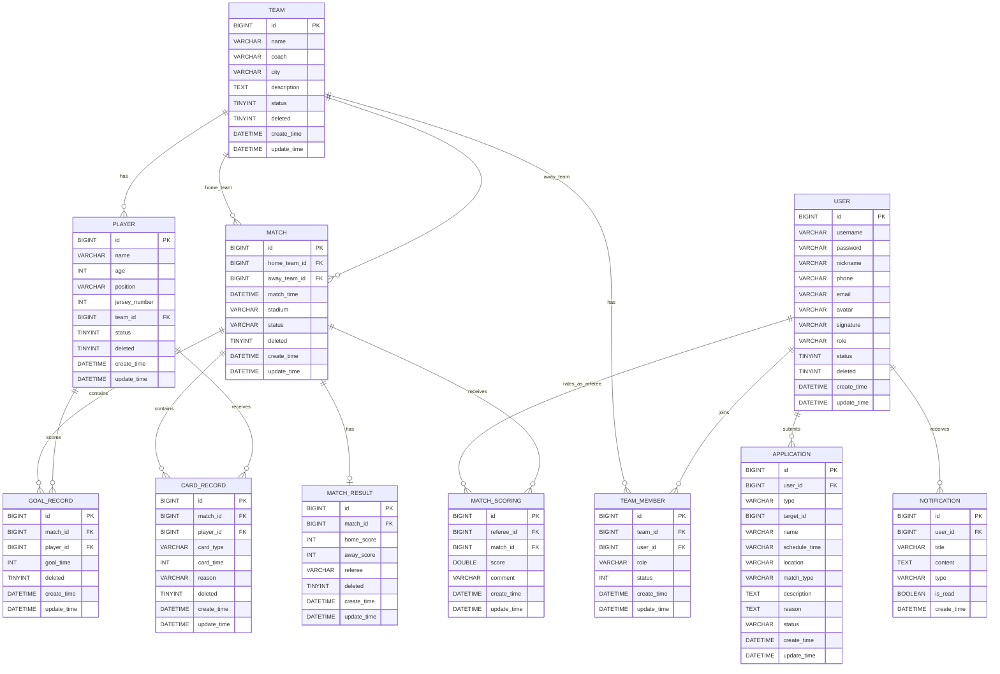

# 足球比赛管理系统 ER 图

基于后端实体类与数据库初始化/迁移代码整理。

说明：
- `user`、`team`、`player`、`match`、`match_result`、`goal_record`、`application`、`notification` 在 [init.sql](backend/src/main/resources/db/init.sql) 或迁移报告中可直接确认。
- `card_record` 由 [CardRecordServiceImpl.java](backend/src/main/java/com/football/service/impl/CardRecordServiceImpl.java) 启动时自动建表。
- `team_member`、`match_scoring` 在实体中存在，但当前初始化 SQL 未显式建表，关系按实体字段推断。

## 关系说明

- 一个球队可以拥有多个球员；一个球员属于一个球队。
- 一场比赛关联两个球队，分别是主队和客队。
- 一场比赛最多对应一条比赛结果。
- 一场比赛可以有多条进球记录和红黄牌记录。
- 一个球员可以在多场比赛中产生多条进球/牌记录。
- 一个用户可以提交多条申请，也可以收到多条通知。
- `team_member` 表示用户与球队的多对多关系。
- `match_scoring` 表示裁判用户对比赛的评分记录。
- `application.target_id` 是多态关联字段，可能指向球队或比赛，不是严格外键。

## 建议

如果你要把这张图放进课程设计/论文里，建议优先使用这 8 张核心表：
- `user`
- `team`
- `player`
- `match`
- `match_result`
- `goal_record`
- `application`
- `notification`

扩展表 `card_record`、`team_member`、`match_scoring` 可以作为“系统扩展模块”单独说明。
